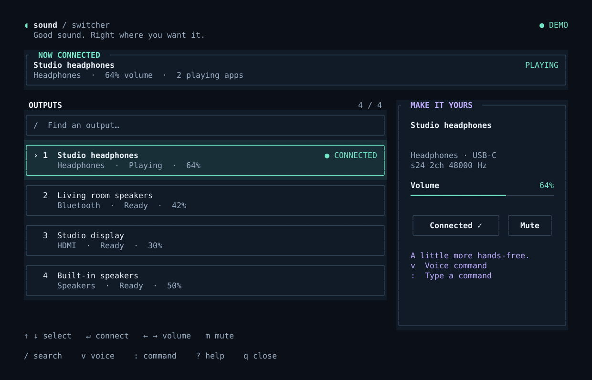

# Sound Switcher

A small, native terminal dashboard for PipeWire and PulseAudio. Connect an
output, bring your playing apps with you, and make the volume feel right.



- **A considered interface:** mint accents, clear selection and connection
  states, friendly device names, and a separate controls panel in wide windows.
- **Comfortable at any zoom:** cards reflow into a compact list, controls move
  below it, and long lists scroll to keep the selection visible. Unicode names
  are truncated by display width. No Nerd Font required.
- **Direct controls:** click or drag the volume bar, mute an output, search by
  name/type/port, or use the keyboard throughout.
- **Live audio:** outputs and external volume changes refresh every three
  seconds. Device selection survives reordering and disconnection. Audio work
  runs in the background with command timeouts and recoverable errors.
- **Optional offline voice:** press `v`, speak once, and stay in control.
  The microphone opens only on request. Recognition runs locally; recordings
  stay in memory. Press `v` or Escape to cancel.
- **A command palette:** press `:` and type the same commands without installing
  speech recognition.

## Build and run

Needs Rust, a Unicode terminal, and `pactl` with JSON support. PipeWire users
need its PulseAudio compatibility service (`pipewire-pulse`).

```sh
cargo build --release
./target/release/sound_switcher

# Explore sample devices without changing your system audio or using the mic.
./target/release/sound_switcher --demo

# Install after building.
install -Dm755 target/release/sound_switcher ~/.local/bin/sound_switcher
```

The dashboard stays open after a connection. Use `--once` for the original
quick-picker behavior, closing after a successful switch. `--no-mouse` preserves
your terminal's mouse/text-selection behavior; Shift+selection also works in
many terminals. `--help` lists the options.

## Controls

| Key | Action |
| --- | --- |
| `↑` / `↓`, `j` / `k` | Select an output |
| Enter | Connect and move playing apps |
| `←` / `→`, `-` / `+`, `h` / `l` | Selected device volume ±5%, capped at 100% |
| `m` / Space | Mute or unmute the selected device |
| `/` | Search; Enter keeps results, Escape clears them |
| `1`–`9` | Focus an output in the filtered list |
| Home / End, Page Up / Page Down | Browse longer lists |
| `:` | Type a command |
| `v` | Listen once; press again to cancel |
| `r` | Refresh outputs immediately |
| `e` | Read the full status/error message |
| `?` / F1 | Open shortcut help |
| `q` / Ctrl+C | Close; pending audio changes finish first |

Click a device to select it, then its **Connect** button to connect. Click or
drag the volume bar to set its level. Scroll to browse. Footer shortcuts are
clickable too. Escape closes dialogs, cancels recording, clears a search, or
closes the app, in that order. Scroll or use arrow keys inside longer dialogs.

Use your terminal's usual zoom shortcuts. The app responds to the resulting
terminal dimensions; it does not change the terminal font. The full two-column
layout appears when at least 96 content columns and sufficient height are
available. Smaller windows use one column, with a minimal mode down to 24 × 7
cells. Below that, an enlargement hint appears and the keyboard still works.

[See the compact layout.](docs/compact.png)

## Voice and typed commands

Commands target the connected output, including a connection still being
applied. Keyboard and mouse volume/mute controls target the **selected** output.

| Command | Result |
| --- | --- |
| `switch to headphones` | Connect a uniquely matching device |
| `switch to Jabra` | Match part of a device name |
| `next output` / `previous output` | Cycle connected outputs |
| `volume 50` / `set volume to fifty percent` | Set volume from 0–100% |
| `louder` / `quieter`, `volume up` / `volume down` | Adjust volume by 5% |
| `mute` / `unmute` | Set the mute state |
| `cancel` | Do nothing |

Ambiguous names filter the list for you to choose; they never switch to an
arbitrary device. Unknown commands and invalid volumes display a message.
Voice recognition uses an English model and the English commands above.

### Optional voice setup

The regular switcher and typed commands need no Python dependencies. Voice uses
[Vosk](https://alphacephei.com/vosk/install) and
[python-sounddevice](https://python-sounddevice.readthedocs.io/en/latest/installation.html).
Install the system PortAudio runtime if needed (`portaudio` on Arch,
`libportaudio2` on Debian/Ubuntu), then create a dedicated Python environment:

```sh
python3 -m venv ~/.local/share/sound-switcher/voice-venv
~/.local/share/sound-switcher/voice-venv/bin/pip install vosk sounddevice
```

Download a small English model from the official
[Vosk model catalog](https://alphacephei.com/vosk/models), such as
`vosk-model-small-en-us-0.15`, and extract it under
`~/.local/share/sound-switcher/`. Point to the extracted **model folder**, not
the ZIP or its parent directory:

```sh
export SOUND_SWITCHER_VOICE_MODEL="$HOME/.local/share/sound-switcher/vosk-model-small-en-us-0.15"
export SOUND_SWITCHER_VOICE_PYTHON="$HOME/.local/share/sound-switcher/voice-venv/bin/python"
sound_switcher
```

Press `v`, wait for **Listening**, and speak within four seconds. The first
request includes model loading time. Recognition uses the default input device
at 16 kHz mono. No model is downloaded automatically, and no audio is sent over
the network. A missing model opens setup guidance; microphone or dependency
errors can be read in full with `e`. Demo mode never records audio.

For a Hyprland launch, set these environment variables in Hyprland's config
with absolute paths; shell exports do not reach an already running compositor:

```ini
env = SOUND_SWITCHER_VOICE_MODEL,/home/YOUR_USER/.local/share/sound-switcher/vosk-model-small-en-us-0.15
env = SOUND_SWITCHER_VOICE_PYTHON,/home/YOUR_USER/.local/share/sound-switcher/voice-venv/bin/python
```

## Hyprland keybind

With Kitty:

```ini
bind = $mainMod, F8, exec, kitty --class sound-switcher -e ~/.local/bin/sound_switcher
```

With Foot:

```ini
bind = $mainMod, F8, exec, foot --app-id=sound-switcher ~/.local/bin/sound_switcher
```

Append `--once` to either command for a quick picker.

## Development and verification

```sh
cargo fmt --check
cargo clippy --all-targets -- -D warnings
cargo test
cargo build
python3 -m unittest discover -s tests -v

# Render the real interface at wide, standard, and compact sizes to SVG.
cargo run --example preview -- /tmp/sound-switcher-previews
```

Rust tests cover audio parsing, command interpretation, device selection,
Unicode, zoom boundaries, and overlays. Python integration tests launch the
real binary in a pseudo-terminal with isolated fake audio/voice backends. They
exercise stream migration, queued volume/mute changes, failure recovery,
search, resizing, voice cancellation, and terminal restoration without changing
your system audio. Live microphone recognition depends on your installed model
and input hardware and should be checked locally after voice setup.

The code separates audio operations, app state, rendering, subprocess handling,
and voice recognition so each can evolve independently.
